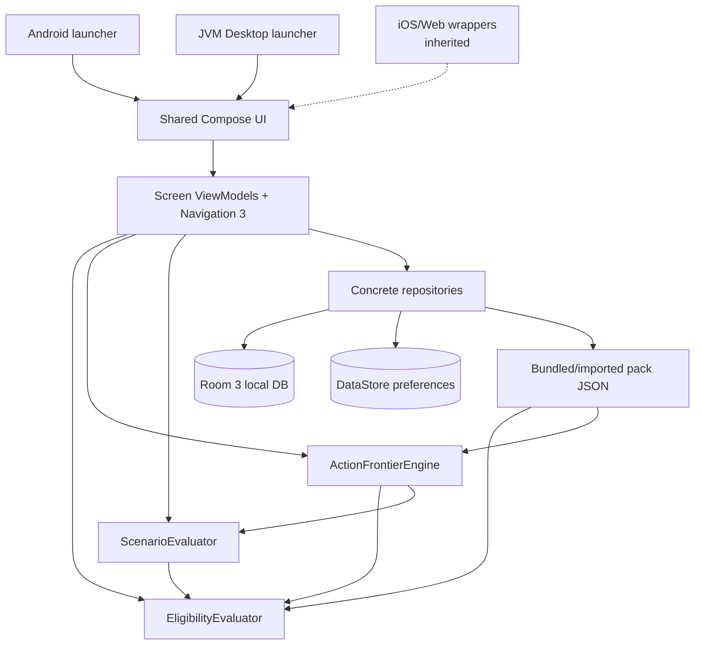

# PORTA — Báo cáo bối cảnh sản phẩm và kỹ thuật

> **Mục đích:** hồ sơ factual dành cho product/UX audit độc lập  
> **Snapshot nghiên cứu:** working tree ngày 24/10/2026  
> **Phạm vi:** `MobileApp/`, `../AiGuidelines/project/`, `../PROGRESS_FEATURES.md`, shared domain/data/presentation, design system, target launchers, build configuration và tests  
> **Phương pháp:** static source trace; không gọi nguồn web, không sửa application code, không chạy Gradle/tests  
> **Lưu ý:** onboarding đang có thay đổi chưa commit trong working tree; báo cáo mô tả trạng thái file hiện thấy, không chỉ `HEAD`.

## Cách đọc và mức độ bằng chứng

Báo cáo dùng các nhãn sau để tránh trộn ý định với thực tế:

| Nhãn | Ý nghĩa |
|---|---|
| **Ý định** | Được mô tả trong PRD/research/README, chưa đủ để kết luận code đã làm. |
| **Đã triển khai** | Có đường đi runtime từ navigation hoặc bootstrap và có implementation cụ thể. |
| **Một phần** | Có model/engine/UI nhưng thiếu một phần acceptance criteria hoặc chỉ hỗ trợ subset. |
| **Demo/prototype** | Chỉ chứng minh interaction bằng dữ liệu synthetic hoặc fixture; không đại diện real corpus. |
| **Đã lên kế hoạch** | P1/P2 hoặc delivery plan, không tìm thấy implementation tương ứng. |
| **Inherited/unreachable** | Mã starter-kit vẫn tồn tại nhưng không nằm trong PORTA navigation graph. |
| **Suy luận** | Kết luận hợp lý từ nhiều nguồn; được ghi rõ là suy luận. |
| **Chưa biết** | Repository không đủ bằng chứng. |

Không test nào được chạy trong lần nghiên cứu này. Những câu như “scorecard ghi PASS” chỉ phản ánh tài liệu nội bộ, không phải xác nhận mới của báo cáo.

---

## 1. Executive Product Overview

### Tóm tắt ngắn

PORTA là ứng dụng planning local-first cho sinh viên. Thay vì đưa ra “match score” hoặc dự đoán khả năng trúng học bổng, PORTA:

1. đối chiếu profile hiện tại với một catalog opportunity có rule được curator mã hóa;
2. giải thích từng published check là pass, fail, thiếu dữ liệu hay cần manual review;
3. tạo các milestone có thể kiểm soát từ action template đã curated;
4. lọc và xếp các milestone theo thời gian, effort, cost và saved priorities;
5. cho người dùng preview một thay đổi giả định mà không sửa profile thật;
6. lưu một active milestone và chỉ cập nhật profile sau xác nhận riêng.

Product promise trong PRD/README là:

> See which realistic next milestone creates the most verified progress—without pretending to predict who wins.

### Vấn đề sản phẩm

PORTA nhắm vào khoảng trống sau bước discovery: sinh viên có nhiều link học bổng, internship, academic program và student contest nhưng thiếu câu trả lời đáng tin cho “điều kiện nào đang pass?”, “điều kiện nào còn thiếu?” và “với nguồn lực hữu hạn, milestone nào tạo thêm nhiều khả năng nhất?”.

Nó không được định vị như scholarship feed, admissions predictor, application manager hay AI mentor. Điểm phân biệt dự kiến là **constrained Action Frontier**: tự động liệt kê các action curated, mô phỏng rule deltas trên nhiều opportunities, loại action không phù hợp planning constraints, rồi giữ một Pareto frontier có giải thích.

### Người dùng dự kiến

- **Primary — “Lan”:** sinh viên năm 2–3, ban đầu thiên về IT students, có GPA, English result, projects/activities phân tán, ít thời gian/tiền và không tin match percentage không giải thích.
- **Secondary — “Minh”:** giảng viên/counselor muốn tái sử dụng cách giải thích opportunity minh bạch. P0 không có teacher account hoặc authoring workflow nên persona này chủ yếu được phục vụ qua bundled pack.
- **Desktop planner:** vẫn là sinh viên, nhưng cần không gian rộng để so sánh milestones, scenario và rule/source diagnostics.

Nguồn: `PORTA_PRD.md` mục 1–6; `README.md` mục What Porta does/Demo path.

### Core value và triết lý

Các nguyên tắc được phản ánh trực tiếp trong code:

- deterministic before intelligent;
- eligibility không phải probability;
- `UNKNOWN` không bị coi là `FAIL`;
- soft/readiness criteria không đổi eligibility;
- actual profile và hypothetical scenario không trộn;
- chỉ fact controllable/time-dependent mới có thể thành recommendation;
- result gắn với source, cycle và checked date;
- planning constraints là explicit;
- dữ liệu profile và plan lưu local;
- ngôn ngữ tránh phán xét con người.

### Người dùng thực sự có thể hoàn thành gì ở snapshot này

Người dùng có thể đi qua onboarding synthetic, tạo/edit profile local, xem catalog 15 records, lọc/save doors, đọc rule receipt, điều chỉnh planning limits, xem Action Frontier, preview one action, lưu một active plan, complete plan, xác nhận actual profile/rule assertion, import/export pack, export metadata và xóa dữ liệu local.

Hai giới hạn quan trọng nhất:

1. Real bundled pack hiện **không có record nào có thể đạt `OPEN`**: mọi record chưa closed vẫn có manual blocker hoặc deadline TBA/Missing. `OPEN` được chứng minh bằng synthetic sample/tests, không phải real corpus.
2. “Verified progress” trong engine nghĩa là delta theo rule đã encoded; engine không đánh giá chất lượng evidence và không phân biệt truth của self-reported so với evidence-backed fact.

---

## 2. Product Vision & Strategy

### Long-term vision

Theo PRD: giúp sinh viên đi từ phát hiện opportunity đến chủ động xây capability và evidence cần thiết để tiếp cận nó.

### Mục tiêu contest/MVP ngắn hạn

P0 được đóng khung như một planning engine nhỏ, polished, chạy offline, gồm:

- profile local;
- curated opportunity pack;
- deterministic eligibility receipts;
- ethical action generation;
- constraint-aware Pareto frontier;
- one-action What-if preview;
- local active plan và explicit actual update;
- Android + JVM Desktop với domain/persistence/most UI ở shared Kotlin.

PRD yêu cầu magic moment dưới 30 giây trong sample mode. Scorecard ngày 24/10/2026 ghi trust-first core journey đã được implement nhưng stabilization/submission evidence còn tiếp tục.

### Use cases dự kiến

1. Self-check một catalog nhỏ có source.
2. Hiểu tại sao một opportunity cần action hoặc verification.
3. Chọn next milestone theo horizon/effort/cost.
4. Xem một action ảnh hưởng nhiều opportunities ra sao.
5. Theo dõi milestone rồi xác nhận actual progress.
6. Trên Desktop, xem master-detail Frontier và Pack Inspector.

### Core hypotheses được tài liệu hóa

- Vấn đề không chỉ là thiếu listings mà là thiếu guidance có thể giải thích về reachable future.
- Người dùng đánh giá cao cross-opportunity marginal gain hơn generic profile score.
- Deterministic source-linked reasoning tạo trust cao hơn AI probability.
- Constraints làm cho recommendation có nghĩa hơn “best action” tuyệt đối.
- Android phù hợp quick tracking; Desktop phù hợp dense comparison/inspection.

Repository không chứa user interviews, analytics, retention data, market traction hoặc usability study để xác nhận các hypotheses này. `IDEA_RESEARCH_REPORT.md` là desk research/concept selection, không phải market validation.

### Success criteria đã ghi

- judge chạm magic preview trong dưới 30 giây;
- demo 3–5 phút giải thích được input → deterministic transformation → result → KMP value;
- ít nhất năm curated milestones tạo legitimate deltas;
- same profile + pack + clock cho cùng result trên Android/Desktop;
- 100 opportunities dưới 100 ms theo mục tiêu PRD;
- P0 offline;
- invalid import atomic/non-destructive;
- hard rules có source note/checked date;
- no soft criterion hoặc immutable fact bị biến thành action.

Hai product spec còn ghi performance target khác nhau: `PORTA_PRD.md` đặt 100 opportunities dưới 100 ms, trong khi `../AiGuidelines/project/prd.md` đặt 50 opportunities dưới 250 ms sau input settle. Không có evidence benchmark hiệu năng mới trong lần audit này; target authoritative vì vậy chưa rõ.

### Explicit non-goals

Contest build không nhằm làm admission/funding probability, crawler, auto-submit, essay/CV generation, chatbot, community, marketplace, cloud sync, global coverage, automatic GPA conversion, arbitrary legal-rule interpretation hoặc guarantee eligibility. PRD còn tuyên bố không Firebase, paywall, subscription, credit hoặc ads trong contest experience.

### Trade-offs và phạm vi

- 15 records chất lượng hơn catalog lớn nhưng nông.
- Manual checks được giữ manual, làm real states bảo thủ.
- Cost là band, không là currency.
- Một scenario tại một thời điểm; multi-scenario là P1.
- Evidence là metadata, không bundle private binary ở P0.
- Desktop authoring/Opportunity Studio, reminders, update diff, Vietnamese localization là P1/P2.
- Contest targets chính thức là Android + JVM Desktop; iOS/Web là inherited compatibility scaffolding.

### Mâu thuẫn chiến lược cần reviewer biết

README/PRD tuyên bố core contest flow không cần account, Firebase hoặc network. Tuy nhiên `root/AppInitializer.kt` vẫn gọi inherited startup cho Remote Config/Analytics/notifications/auth và `UserRepository.signInAnonymouslyIfNecessary()` dùng KMPAuth/Firebase backend. Premium initialization được tắt bởi `PREMIUM_FEATURES_ENABLED=false`, nhưng anonymous auth không có gate tương tự. Vì không chạy app/network trace, tác động runtime thực tế khi config trống là **chưa xác minh**. Đây là khác biệt giữa product promise và bootstrap code, không phải bằng chứng rằng profile/eligibility được cloud-sync.

---

## 3. Complete Feature Inventory

| Feature | Mục đích / entry point | Tương tác và state chính | Phụ thuộc | Trạng thái / giới hạn |
|---|---|---|---|---|
| Onboarding | App start → `OnBoardingScreenRoute` | 4 steps: goal, IELTS synthetic interaction, result, chọn sample hoặc profile | `OnBoardingViewModel`, DataStore | **Đã triển khai**, working tree mới; goal chỉ sort demo cards, không personalization. |
| IELTS demo | Onboarding step 2–3 | 6.5 → 7.0; bốn fictional doors đổi rule state | `PortaSampleData`, real `EligibilityEvaluator` | **Demo-only**; không dùng `ScenarioEvaluator`/Frontier và không dùng real opportunity rules. |
| Explore sample | CTA onboarding | Kết thúc onboarding, không persist sample profile | Doors/Frontier fallback | **Đã triển khai**; khi real pack active, sample profile được evaluate với real pack, không phải luôn synthetic-with-synthetic. |
| Profile setup/edit | Onboarding hoặc Profile → Edit | nhập study/field và optional facts; save/delete omitted optionals | Room `profile_fact` | **Đã triển khai một phần**; chỉ study level + field bắt buộc; language type/date và detailed experience chưa có. |
| Profile overview | Tab Profile | sections, fact provenance/actionability, doors dùng fact, delete, export, clear | `StudentProfileViewModel` | **Đã triển khai**; profile import UI không tìm thấy. |
| Growth evidence | Profile setup | community project/leadership text + evidence reference | encoded `TextValue` | **Một phần**; không ảnh hưởng eligibility của real pack. |
| Doors/discovery | Tab Doors | counts, status filters, Saved filter, cards, reactive highlight | pack/profile/saved repos, evaluator | **Đã triển khai**; không thấy text search/category/deadline filter như PRD; filtered-empty state riêng không tìm thấy. |
| Opportunity detail | Tap Door | conclusion, source metadata, rule receipts, soft criteria, action preview | `OpportunityDetailViewModel` | **Đã triển khai một phần**; action link chọn first referenced template, không chắc là unmet rule và không áp constraints; source URL chỉ render text, cycle/save/readiness không hiện. |
| Eligibility evaluation | Mọi Door/detail/frontier | typed tree → receipts → five overall states | `EligibilityEvaluator` | **Đã triển khai** cho supported types; real pack rất conservative và không thể reach `OPEN`. |
| Saved opportunities | Save icon/card | optimistic toggle, persist by profile/opportunity | Room `saved_opportunity` | **Đã triển khai**; không đổi eligibility, chỉ Frontier khi priority bật. |
| Planning limits | Frontier controls | horizon 30/90/180/365, max effort, max cost, prioritize saved | DataStore | **Đã triển khai**; experience actions 720/1080 ngày luôn vượt UI max 365. |
| Next moves / Action Frontier | Tab Frontier | candidates, exclusions, Pareto, deterministic order | profile/pack/saves/evaluator/scenario | **Đã triển khai**; UI không giới hạn 5 như PRD; explanation thiếu một số factors. |
| Action recommendation | Frontier first card | first ranked frontier item gắn “Recommended next move” | lexicographic rank | **Đã triển khai**, không phải ML/AI; recommendation chỉ tốt theo encoded metrics. |
| Pareto frontier plot/workspace | Frontier | compact cards; wide master-detail/plot và selectable impact map | `FrontierScreen`, `FrontierPlot` | **Đã triển khai**; dominance theo counts, không set semantics/confidence/deadline uncertainty. |
| What-if simulation | Tap Frontier/detail action | Actual vs Scenario, changed doors, add/discard | `ScenarioEvaluator` | **Đã triển khai**; không persist scenario; exact remaining gaps không render. |
| Opportunity impact preview | Scenario/wide Frontier | newly open vs improved; timing unverified | receipt/rule deltas | **Đã triển khai một phần**; unchanged doors có trong state nhưng full screen không render. |
| Active plan | Frontier/Scenario → save | một current item, status planned/in progress/paused/completed | Room `plan_item` | **Đã triển khai** nhưng `replaceForProfile` xóa plan cũ; không phải multi-item plan. |
| Actual profile update | Completed plan → update | profile fact hoặc scoped assertion, optional/required evidence | Profile/RuleAssertion repo | **Đã triển khai**; achieved value có thể khác target và recompute theo actual. |
| Pack Inspector | Profile → Data sources | metadata, diagnostics, opportunity/rule tree, import/export/restore | codec/parser/validator/FileKit | **Đã triển khai một phần**; valid import activate ngay, không update diff/preview. |
| Profile data controls | Profile | export metadata, clear facts/assertions/plans | ProfileExportCodec/FileKit | **Đã triển khai một phần**; decode/import API có nhưng không thấy profile-import UI; clear flow không xóa saved opportunities, active pack hay DataStore preferences. |
| Adaptive Desktop | cùng navigation | rail ≥840 dp; Frontier/Pack master-detail | shared Compose | **Đã triển khai**; actual rail chỉ 3 top-level tabs, không đủ 6 mục như PRD desktop IA. |
| Light/dark theme | system theme | platform system appearance + shared tokens | designsystem | **Đã triển khai**. |
| Source refresh | N/A | manual pack update/import | source register | **Không tự động**; không scraper, sync, stale threshold hoặc signed registry. |
| Opportunity Studio | PRD P1 | form authoring | chưa tìm thấy | **Đã lên kế hoạch / not found**. |
| Reminder / multi-scenario / pack diff | PRD P1 | — | — | **Đã lên kế hoạch / not found**. |
| Cloud workspace/registry/OCR AI | PRD P2 | — | — | **Đã lên kế hoạch / not found**. |

Các screen `home`, `gallery`, `generationresult`, `account`, `signin`, `paywall`, `subscriptions`, `creditbalance` và optional AI/billing/ads code vẫn có trong starter kit nhưng không được `AppNavigation.screens()` đăng ký. Chúng không nên được tính là PORTA user-facing features, dù một phần bootstrap dependency vẫn chạy.

Design/user-flow docs cũ hơn có drift: onboarding spec nêu năm lựa chọn (thêm Student contests và Show me all), trong khi `OnboardingGoal.selectableEntries` chỉ có ba; trust-before-data screen riêng được implementation gộp vào bốn-step story khác. `../PROGRESS_FEATURES.md` vẫn ghi Starter cleanup chưa xong và navigation/keyboard/large-text/reduced-motion chưa complete.

---

## 4. End-to-End User Journeys

### A. First launch → onboarding → sample exploration

**Start:** route luôn tạo Onboarding trước. Nếu `KEY_IS_ONBOARD_SHOWN=true`, ViewModel lập tức emit completion với `SAMPLE_MAP` và navigation replace sang Doors; returning user không phải đi lại các bước. Selected goal được restore từ DataStore.

1. Chọn Scholarships, Internships hoặc Exchange programs.
2. Kéo IELTS synthetic từ 6.5 đến 7.0; slider round half-band và clamp nên thực tế chỉ có 6.5/7.0.
3. Bốn fictional cards đổi IELTS requirement sang met; step tiếp chỉ mở khi cả bốn pass.
4. Xem before/after, một receipt giải thích và disclaimer.
5. Chọn “Explore sample” hoặc skip → `DoorsScreenRoute`.
6. Vì chưa có real facts, Doors dùng `PortaSampleData.profile`. Nếu bundled pack đã active, profile synthetic được evaluate với 15 real records; nếu pack chưa tới, UI tạm dùng 5 synthetic opportunities.

**Success:** Doors render sample banner/status counts. **Failure/unknown:** pack install async có thể tạo transient synthetic catalog; không thấy onboarding error surface. Goal chỉ đổi thứ tự demo, không filter catalog sau đó.

### B. First launch → onboarding → real profile

1. Hoàn tất/skip demo và chọn “Build my map”.
2. Navigate `ProfileSetupScreenRoute`.
3. Study level và field of study là hai input bắt buộc; GPA, IELTS, nationality, residency, age, experience, enrollment, degree, project và leadership là optional.
4. Valid inputs được upsert; optional đã bị xóa khỏi form sẽ bị delete khỏi Room.
5. Success → set Doors root.

**Failure:** ViewModel hiển thị local-save error. **Unknown states:** field thiếu trở thành `UNKNOWN`/`REVIEW`, không tự fail. README nói “six local profile facts”, nhưng code cho phép save với hai.

### C. Profile creation → eligibility evaluation

Room flows emit `ProfileSnapshot`; Doors/detail/frontier re-evaluate in memory với active pack và injected local date. UI tạo counts/cards theo five `EligibilityState`s. Saved state được combine nhưng không đổi receipt. Evidence/provenance không đổi rule truth.

**Success:** user thấy deterministic conclusion và primary reason. **Important:** real pack không thể kết thúc ở `OPEN` ở snapshot này; phổ biến là `NEEDS_INFO`, `HAS_GAPS`, `NOT_ACTIONABLE`, cộng Swift `CLOSED`.

### D. Opportunity discovery → detail

1. Doors tab → filter All/Current checks passed/Needs action/Needs verification/Not available/Closed/Saved.
2. Save/unsave optimistic hoặc tap card.
3. `OpportunityDetailScreenRoute(opportunityId)` lấy receipt reactive.
4. Detail hiển thị source/cycle/deadline/checked date, hard receipts, manual checks, soft criteria và disclaimer.
5. Có thể preview một linked action. Trên detail hiện tại source URL chỉ là text, không gọi URI handler; Pack Inspector mới có source link clickable.

**Empty/failure:** missing opportunity/pack trở thành not-found/loading UI tùy ViewModel; no text search. Action shortcut không lọc chắc chắn rule chưa thỏa.

### E. Opportunity → unmet requirements → next action

Expected product flow tồn tại nhưng không hoàn toàn strict:

- receipt cho biết actual vs expected và `PASS/FAIL/UNKNOWN/REVIEW`;
- failed actionable atomic có template có thể trở thành Frontier candidate;
- detail’s preview action lấy action-template reference đầu tiên, không dùng full Frontier feasibility/ranking;
- failed rule không template không tạo advice;
- manual/soft requirement không tạo eligibility-unlocking advice.

Vì vậy flow hoàn chỉnh đáng tin hơn khi đi qua Frontier thay vì CTA trực tiếp từ detail.

### F. Planning constraints → ranked recommendations

1. Frontier lấy profile thật, hoặc sample profile nếu profile rỗng.
2. Load preferences (default 90 days, VERY_HIGH, Any cost, prioritize saved on).
3. Generate/deduplicate candidates.
4. Simulate mỗi action trên all doors.
5. Loại constraints/deadlines/no-impact; compute Pareto; lexicographic rank.
6. First card = recommended, còn lại alternatives; exclusions có diagnostic reason.

**Empty:** có thể không có action nếu facts missing tạo `UNKNOWN` (profile-scoped candidate chỉ sinh từ `FAIL`), constraints quá chặt, hoặc gaps không có curated template.

### G. Action preview → What-if result

1. Tap action → `ScenarioPreviewScreenRoute(actionId)`.
2. ViewModel tìm template, build scenario overlay/assertion.
3. UI giữ banner “Simulation — your saved profile is unchanged.”
4. Hiển thị Actual vs Scenario target và changed doors thành “Would pass current checks” hoặc “Would address one checked requirement/Still needs verification”.
5. Discard = back; Add milestone = persist one PlanItem nếu có real profile.

Sample-only user được dẫn sang build profile thay vì lưu plan. Simulation không persist và không sửa actual profile.

### H. Profile changes → recomputation

- Edit Profile upsert/delete facts → Room Flow → Doors/detail/frontier recompute.
- Complete plan chỉ đổi `PlanStatus`; chưa đổi facts.
- Actual Update sau completed plan mới upsert fact hoặc scoped assertion.
- Scoped assertion chỉ hợp lệ nếu opportunity/rule/fingerprint vẫn match.
- Doors highlight card có state/primary reason thay đổi.

Date không phải Flow; app mở qua nửa đêm không tự recompute chỉ vì ngày đổi.

### I. Saved opportunities → prioritization

1. Save trong Doors persist `(profileId, opportunityId)`.
2. Frontier observe IDs reactively.
3. Nếu `prioritizeSaved=true`, saved impact counts tham gia cả dominance và ranking.
4. Toggle off zero các saved dimensions nhưng không xóa saves.

Saving không đổi eligibility. Text UI nói giữ saved milestones visible/rank first, trong khi implementation có thể làm action cho saved door dominate và loại action unsaved khỏi frontier.

---

## 5. Eligibility Engine — Deep Technical Explanation

### 5.1 Requirement representation

`domain/model/Opportunity.kt` định nghĩa:

- `RuleNode.All(children)`;
- `RuleNode.Any(children)`;
- `RuleNode.Atomic(id, factKey, operator, expected, explanation, sourceNote, actionability, actionTemplateId)`;
- `RuleNode.ManualCheck(id, explanation, sourceNote)`.

Không có `HARD` enum runtime. Atomic/manual tree là eligibility graph. `softCriteria` và `readinessItems` là collections riêng; soft criteria không được evaluator đọc. Readiness items có trong data nhưng không tìm thấy presentation consumer trong main journey.

### 5.2 Profile-to-rule matching

Supported operators: `EXISTS`, `EQUALS`, `NOT_EQUALS`, `GREATER_THAN_OR_EQUAL`, `LESS_THAN_OR_EQUAL`, `IN_SET`, `CONTAINS_ANY`, `CONTAINS_ALL`, `DATE_BEFORE`, `DATE_AFTER`.

- Number/duration chỉ comparable khi unit string giống hệt.
- Không convert 10-point ↔ 4-point GPA, month ↔ hour hoặc TOEFL ↔ IELTS.
- Enum/text comparison exact và case-sensitive.
- `DATE_BEFORE/AFTER` strict; equal date không pass.
- Thiếu fact/type mismatch/unit mismatch → `UNKNOWN`, không `FAIL`.
- Manual check luôn `REVIEW`.

### 5.3 Atomic results và truth tables

| `RuleResult` | Nghĩa |
|---|---|
| `PASS` | Known typed value thỏa condition. |
| `FAIL` | Known, comparable value trái condition. |
| `UNKNOWN` | Thiếu hoặc không so sánh an toàn. |
| `REVIEW` | Cần người dùng/source review; engine không kết luận. |

Aggregation:

- `ALL`: bất kỳ `FAIL` → FAIL; nếu không, REVIEW → REVIEW; nếu không, UNKNOWN → UNKNOWN; tất cả PASS → PASS.
- `ANY`: bất kỳ PASS → PASS; nếu không, REVIEW → REVIEW; nếu không, UNKNOWN → UNKNOWN; tất cả FAIL → FAIL.

Một manual alternative trong `ANY` do đó có thể giữ root ở `REVIEW` khi typed branch fail.

### 5.4 Overall eligibility states

`EligibilityEvaluator.evaluate()` dùng precedence:

1. known deadline trước `today` → `CLOSED`;
2. root PASS nhưng deadline TBA/Missing → `NEEDS_INFO`;
3. root PASS và known deadline chưa qua → `OPEN`;
4. root UNKNOWN/REVIEW → `NEEDS_INFO`;
5. root FAIL và có ít nhất một failed atomic controllable/time-dependent → `HAS_GAPS`;
6. root FAIL còn lại → `NOT_ACTIONABLE`.

| Internal | UI | Điều kiện chuyển vào/ra |
|---|---|---|
| `OPEN` | Current checks passed | Tất cả encoded root checks PASS + known active deadline. Bất kỳ missing/manual/deadline unknown kéo ra khỏi OPEN. |
| `HAS_GAPS` | Needs action | Root FAIL và tồn tại ít nhất một actionable failed leaf. Sửa leaf có thể vẫn để immutable fail. |
| `NEEDS_INFO` | Needs verification | Root UNKNOWN/REVIEW hoặc root PASS nhưng deadline chưa biết. Add fact/assertion/source deadline có thể đổi state. |
| `NOT_ACTIONABLE` | Not available this cycle | Root FAIL nhưng không còn actionable failed leaf. |
| `CLOSED` | Closed | Known deadline đã qua; deadline precedence override rule result. |

Pass một leaf không có nghĩa overall eligible. `OPEN` cũng chỉ có nghĩa current encoded checks pass, không selection/funding probability.

### 5.5 Deadline handling

`Deadline` gồm `Known(LocalDate)`, `Tba`, `Missing`. Không lưu time/timezone. Opportunity vẫn active trong cả local calendar date của deadline, đóng từ ngày tiếp theo. `cycleStartOn` và `archived` không tham gia evaluator; Swift bị `CLOSED` do old known date, không phải do `archived=true`.

### 5.6 Country, education, GPA, IELTS, experience, age và enrollment

| Area | Representation/behavior thực tế |
|---|---|
| Country/nationality/residency | profile lưu ISO alpha-2, nhưng all country-specific rules trong real pack là manual; không typed country eligibility. |
| Study level/field | được thu thập; không real atomic rule dùng. Programme/course fit vẫn manual. |
| GPA | 4.0/10.0 scale preserved; không conversion; không real atomic rule dùng. |
| IELTS | number 0–9, không test date/type/half-band validation; chỉ synthetic sample dùng. |
| Experience | total months; DAAD ≥24, JJ/WBGSP ≥36. Paid/relevant/post-degree semantics manual. |
| Age | current integer years; Kotlin/Schwarzman/UNICEF/GSoC typed. Không DOB/reference-date computation; Schwarzman future-age semantics bị giản lược. |
| Enrollment | nullable Boolean; 7 records dùng, dù full-time/stage/continuity thường phức tạp hơn. |
| Degree | Boolean completed; 5 records dùng; level/equivalence/date manual. |
| Full-period availability | four programme-scoped assertions, không dùng global fact. |

### 5.7 Scoped rule assertions và evidence

Availability action dùng `OpportunityRuleTarget(opportunityId, ruleId, ruleFingerprint, ...)`. Evaluator:

1. lookup exact opportunity+rule;
2. kiểm tra profile ID, fact key, fingerprint;
3. bỏ qua global fact cho scoped rule;
4. stale/missing assertion → UNKNOWN.

Fingerprint bao gồm semantic fields của atomic rule, kể cả explanation/source note/action template ID; source wording đổi có thể làm assertion stale.

`FactProvenance` và `EvidenceMetadata` không tham gia PASS/FAIL. Evidence-backed và self-reported value giống nhau cho cùng result. “Verified” ở đây là source-linked deterministic delta, không phải external verification của người dùng.

### 5.8 Recalculation và edge cases

Receipts không persist; ViewModels observe profile/pack/saves và re-evaluate. Scenario copy không mutate profile. Completing plan không update truth. Current date không reactive.

Edge case: `ALL(immutable FAIL, actionable FAIL)` → `HAS_GAPS`; sau action, immutable FAIL còn lại → `NOT_ACTIONABLE`. Vì vậy `Needs action` không bảo đảm action có thể mở door.

### 5.9 Worked examples

**Erasmus, degree complete:** degree atomic PASS; `ANY(degree, final-year manual)` root PASS; deadline TBA → `NEEDS_INFO`, không OPEN. Degree false làm typed branch FAIL nhưng manual branch REVIEW → vẫn NEEDS_INFO.

**Mixed immutable/actionable:** age over limit + degree incomplete → HAS_GAPS vì degree time-dependent. Complete degree → remaining age fail làm NOT_ACTIONABLE.

**OECD scoped availability:** enrolled true PASS; global availability ignored; no assertion → UNKNOWN; field/language manual REVIEW → NEEDS_INFO. Assertion đúng fingerprint làm availability PASS nhưng manual check vẫn giữ NEEDS_INFO. Pack semantic đổi → assertion stale → UNKNOWN.

### 5.10 Correctness limitations

- Real pack không có current `OPEN` outcome.
- No confidence score/model; uncertainty categorical only.
- No live-source validation, stale threshold hoặc archived behavior.
- Current age không thể đánh giá age-at-reference-date chính xác.
- General booleans giản lược full-time/stage/degree equivalence.
- Missing profile fact tạo UNKNOWN; profile-scoped action generator chỉ sinh từ FAIL nên app thường không recommend “add/verify missing fact”.

Nguồn chính: `domain/model/Opportunity.kt`, `domain/model/ProfileFact.kt`, `domain/usecase/EligibilityEvaluator.kt`, `domain/model/RuleFingerprint.kt`, `DoorsViewModel.kt`, `OpportunityDetailViewModel.kt`.

---

## 6. Recommendation Engine & Action Frontier — Deep Technical Explanation

### 6.1 Action/milestone là gì

- `ActionTemplate`: curated definition trong pack.
- `FrontierAction`: runtime action + simulated impact/explanation.
- `PlanItem`: persisted copy có status/date/note.

Target có hai scope:

- `ProfileFactTarget`: global override, có thể tác động nhiều doors;
- `OpportunityRuleTarget`: exact opportunity+rule+fingerprint, chỉ tác động một programme-specific assertion.

Actions không do AI sinh. Mỗi candidate phải có explicit template referenced bởi atomic rule; validator kiểm tra target/actionability/value và dangling reference.

### 6.2 Candidate generation và equivalence

1. Evaluate baseline all opportunities.
2. Resolve action template từ receipts.
3. Profile target cần rule `FAIL`; scoped target chấp nhận `FAIL` hoặc `UNKNOWN`.
4. Group theo signature.
5. Trong group, chọn duration ngắn nhất, sau đó effort, cost, ID.
6. Chỉ `CONTROLLABLE`/`TIME_DEPENDENT` được giữ.

Signature không dựa title:

- global = fact key + target display value;
- scoped = opportunity ID + rule ID + target display value.

IELTS 7.0 từ bốn sample doors collapse thành một action. Bốn programme availability không collapse.

### 6.3 Estimates

| Template family | Duration | Effort | Cost | Nguồn |
|---|---:|---|---|---|
| Complete degree | 180 ngày | HIGH | MEDIUM | hardcoded Porta estimate |
| Eligible enrollment cycle | 30 ngày | LOW | FREE | hardcoded Porta estimate |
| Full-period availability | 14 ngày | LOW | FREE | hardcoded Porta estimate |
| Experience 24/36 months | 720/1080 ngày | VERY_HIGH | FREE | `months * 30`; target total, không remaining delta |
| Synthetic IELTS 7.0 | 45 ngày | MEDIUM | LOW | synthetic demo estimate |

Không có typical range, currency amount, workload schedule, confidence hoặc estimate từ current progress. Provider không supply các estimates này.

### 6.4 Planning feasibility

`PlanningConstraints`: horizon, max effort, max cost, prioritize saved. UI horizon `{30,90,180,365}`, default 90/VERY_HIGH/Any/true; persist DataStore.

Action bị exclude nếu duration > horizon, effort/cost vượt ceiling, không tạo rule improvement, hoặc tất cả affected doors miss known deadlines. Feasibility per door là:

```text
deadlineEpochDay - todayEpochDay >= minimumDurationDays
```

TBA/Missing được coi feasible nhưng gắn timing-unverified. Experience actions 720/1080 ngày không thể vào frontier với max UI horizon 365.

### 6.5 Impact

Engine tính:

- improved doors: relevant hard rule `FAIL → PASS`, scoped `UNKNOWN → PASS` cũng tính;
- newly-open doors: overall non-OPEN → OPEN;
- saved subsets;
- timing-unverified IDs;
- earliest known affected deadline.

“Improved” không đồng nghĩa eligible/open; manual blocker có thể giữ overall NEEDS_INFO.

### 6.6 Pareto dominance và ranking

A dominates B khi no-worse trên mọi dimension và better ít nhất một:

- saved newly-open/improved counts nếu priority bật;
- total newly-open/improved counts;
- shorter duration;
- lower effort;
- lower cost.

Dominance dùng counts, không dùng affected-set inclusion. Earliest deadline và timing uncertainty không tham gia dominance.

Sau đó rank lexicographic:

1. newly-open saved;
2. improved saved;
3. newly-open total;
4. improved total;
5. earliest known deadline;
6. duration;
7. effort;
8. cost;
9. template ID.

Hai action có vector bằng nhau đều tồn tại vì không có strict better. First action được UI gắn “Recommended next move”. Raw score không hiển thị vì implementation không dùng score tổng hợp.

### 6.7 Saved opportunities

Save chỉ đổi frontier khi `prioritizeSaved=true`; không đổi eligibility/simulation. Implementation cho saved counts tham gia dominance, nên saved priority có thể loại một action khác chứ không chỉ reorder. Explanation hiện không nói rõ khi weighting thay đổi order, trái FR-9.

### 6.8 Vì sao có bốn “Reserve the full required programme period”

| Opportunity | Action ID | Rule ID |
|---|---|---|
| OECD | `oecd-full-period-availability` | `oecd-availability` |
| World Bank Treasury | `world-bank-treasury-full-period-availability` | `world-bank-treasury-availability` |
| ESA | `esa-full-period-availability` | `esa-availability` |
| CERN | `cern-openlab-full-period-availability` | `cern-openlab-availability` |

`PortaContestPackData.availabilityAction()` hardcode cùng title, `AVAILABLE_FULL_PERIOD=true`, RULE scope, 14 days, LOW/FREE. Đây là bốn independent per-opportunity instances, không duplicate DB rows. Scoped signature giữ chúng riêng để OECD confirmation không leak sang ESA/CERN/WB. Sau khi lưu plan, title được suffix opportunity; Frontier cards vẫn giống nhau.

14 ngày là planning lead-time do PORTA cấu hình, không inferred, không provider-sourced và không phải programme duration. Repository không giải thích rationale chọn 14. Vì bốn actions có equal resources/impact=1, không action nào dominate action khác; cả bốn có thể cùng hiện.

### 6.9 Synthetic end-to-end examples

**A — one global action, four doors:** IELTS 6.5 làm bốn 7.0 rules FAIL; templates dedup thành one global target; simulate 7.0 → four rule PASS/four synthetic OPEN; profile thật vẫn 6.5.

**B — four scoped availability actions:** mỗi missing assertion tạo UNKNOWN candidate; no dedup vì scope; mỗi simulation chỉ improve one door; manual/deadline uncertainty giữ newly-open=0; equal vectors cùng ở frontier.

**C — saved priority:** IELTS opens 2 unsaved, GPA opens 1 saved, same resources. Priority on → cả hai non-dominated, saved first. Off → IELTS total impact 2 dominates GPA 1.

**D — deadline boundary:** 30-day action với deadline exactly 30 days là feasible; 29 days miss. Nếu đồng thời horizon/effort/cost đều vượt, exclusion có cả ba reasons.

### 6.10 Limitations đối với one-action-to-many

- Chỉ global target cùng fact/value mới collapse và ảnh hưởng nhiều doors.
- Programme availability cố ý scoped nên không thể tạo cross-opportunity gain dù title giống nhau.
- Real pack chỉ dùng năm fact keys typed; GPA/IELTS/project/leadership không tạo real cross-catalog value.
- Real records không reach OPEN, nên real actions chủ yếu “address one check”, không mở door.
- Same-target pre-dedup ưu tiên shortest trước Pareto có thể làm mất trade-off dài hơn nhưng effort thấp.
- Pareto by counts có thể dominate action tác động tập doors khác.
- PRD nói default tối đa 5 actions, UI hiện render toàn frontier.
- Explanation không lưu missed per-door reason/earliest deadline field đầy đủ.
- Imported pack không validate global uniqueness action ID; scenario lookup `firstOrNull` có ambiguity risk.

Nguồn: `domain/model/ActionFrontier.kt`, `domain/usecase/ActionFrontierEngine.kt`, `ScenarioEvaluator.kt`, `PortaContestPackData.kt`, `OpportunityPackValidator.kt`, `FrontierViewModel.kt`, `FrontierScreen.kt`.

---

## 7. What-if Simulation

### Construction

`ScenarioEvaluator` nhận actual `ProfileSnapshot`, `ActionTemplate`, opportunities và today:

- global action → copy facts với `withOverrides()`;
- scoped action → copy/add exact assertion, nếu current rule còn tồn tại;
- evaluate baseline và simulated all opportunities;
- `deltas` giữ overall eligibility state changes;
- source profile object và storage không mutate.

Frontier bổ sung rule-level comparison để vẫn ghi nhận progress khi overall state không đổi.

### UI before/after

- persistent Simulation banner;
- Actual vs Scenario target value;
- changed doors chia newly-open và progressed;
- scoped action notice programme-specific;
- timing-unverified disclosure;
- add to plan/discard.

`unchangedDoors` được build trong state nhưng full-screen preview không render. Exact remaining rule list cũng không render; người dùng thấy generic next state. Điều này yếu hơn PRD yêu cầu “exact rules responsible” và “remaining gaps”.

### Persistence và actual profile

- Scenario không persist.
- Discard chỉ navigate back.
- Add milestone persist one `PlanItem`; sample user không thể plan cho tới khi tạo profile thật.
- Plan completion không đổi profile.
- Actual Update là route riêng, enabled sau completed status.
- Profile target evidence optional; scoped target UI yêu cầu evidence label, reference vẫn optional.
- Sau update, Room flow recompute all results.

### IELTS 6.5 → 7.0 onboarding demonstration

Đây là bespoke demo, không dùng ScenarioEvaluator/Frontier. `PortaSampleData` có năm fictional opportunities:

| Fictional opportunity | Requirement | 6.5 | 7.0 | Có hiện trong affected list? |
|---|---:|---|---|---|
| Aurora Scholars | IELTS ≥7.0 | FAIL/HAS_GAPS | PASS/OPEN | Có |
| Forge Student Lab | IELTS ≥7.0 | FAIL/HAS_GAPS | PASS/OPEN | Có |
| Horizon Exchange | IELTS ≥7.0 | FAIL/HAS_GAPS | PASS/OPEN | Có |
| Spark Fellowship | IELTS ≥7.0 | FAIL/HAS_GAPS | PASS/OPEN | Có |
| Local Makers Challenge | IELTS ≥6.0 | PASS/OPEN | PASS/OPEN | Không; baseline đã pass |

Goal selection chỉ đưa matching category lên đầu. Demo nói rõ fictional và “other conditions are not assessed”. Reset chỉ đổi in-memory slider. Explore sample không ghi profile.

### Hypothetical vs verified progress

- Hypothetical: overlay/assertion in memory; no storage.
- Confirmed actual: upsert fact/assertion sau explicit UI.
- Evidence-backed: metadata do user nhập, không third-party validation.
- Engine result: deterministic against encoded rule, không guarantee provider acceptance.

---

## 8. Opportunity Dataset & Provenance

### Format và schema

Bundled pack là Kotlin-authored `OpportunityPackDocument` được codec serialize thành strict JSON và import Room. Schema v2 có metadata, opportunities, recursive rule nodes, action templates, soft/readiness items và diagnostics. v1 được normalizer hỗ trợ nếu availability mapping không ambiguous.

Metadata hiện tại:

- ID `porta-curated-opportunities-2026-10-21`;
- schema 2, pack version 2;
- checked 21/10/2026;
- publisher “Porta · independently curated from official sources”;
- 15 real records;
- 23 atomic + 22 manual leaves;
- 18 action templates;
- categories: 7 scholarships, 4 internships, 2 academic programs, 2 student contests, 0 fellowship;
- deadlines: 4 known, 9 TBA, 2 Missing/rolling;
- 1 archived record (Swift 2026).

### Bundled records

`A/M/Act` = atomic leaves / manual leaves / action templates.

| ID | Title | Category | Deadline | A/M/Act | Typed rule coverage | Source available |
|---|---|---|---|---:|---|---|
| `kotlin-student-coding-competition-2026` | Kotlin Student Coding Competition | Contest | 07/12/2026 | 2/2/1 | age, enrolled | Có, Kotlin official rules |
| `erasmus-mundus-joint-masters` | Erasmus Mundus Joint Masters | Scholarship | TBA | 1/1/1 | degree completed | Có, Erasmus+ |
| `chevening-scholarship-2027` | Chevening Scholarship | Scholarship | TBA | 1/2/1 | degree completed | Có, Chevening |
| `rhodes-scholarship` | Rhodes Scholarship | Scholarship | TBA | 0/1/0 | entirely manual | Có, Rhodes Trust |
| `schwarzman-scholars-2028-2029` | Schwarzman Scholars | Scholarship | TBA | 3/1/1 | age min/max, degree | Có, Schwarzman |
| `france-excellence-eiffel-2027` | France Excellence Eiffel | Scholarship | 08/01/2027 | 0/1/0 | entirely manual | Có, Campus France |
| `daad-epos-2027-2028` | DAAD EPOS | Scholarship | TBA | 2/2/2 | degree, 24 months experience | Có, DAAD |
| `jj-wbgsp-2027-window-1` | JJ/WBGSP | Scholarship | 26/02/2027 | 2/2/2 | degree, 36 months experience | Có, World Bank |
| `oecd-internship-rolling` | OECD Internship Programme | Internship | Missing/rolling | 2/1/2 | enrolled, scoped availability | Có, OECD |
| `unicef-internship-rolling` | UNICEF Internship Programme | Internship | Missing/vacancy | 2/2/1 | age, enrolled | Có, UNICEF |
| `world-bank-treasury-summer-internship-2027` | World Bank Treasury Summer Internship | Internship | TBA | 2/1/2 | enrolled, scoped availability | Có, World Bank |
| `esa-student-internships` | ESA Student Internships | Internship | TBA | 2/1/2 | enrolled, scoped availability | Có, ESA |
| `cern-openlab-summer-student-2027` | CERN openlab Summer Student Programme | Academic program | TBA | 2/1/2 | enrolled, scoped availability | Có, CERN |
| `google-summer-of-code-next-cycle` | Google Summer of Code | Academic program | TBA | 1/1/0 | age | Có, Google |
| `swift-student-challenge-2026` | Swift Student Challenge | Contest | 28/02/2026, archived | 1/3/1 | enrolled | Có, Apple |

### Provenance, freshness và reliability

- Manual curation; không crawl/auto-refresh.
- Mỗi record có official URL, source note và lastCheckedOn; pack-level source URL null.
- `OPPORTUNITY_PACK_SOURCES.md` mô tả encoding boundary và manual checklist.
- Không có live URL/content check, source snapshot/hash, signature, stale threshold hoặc source-owner SLA.
- Custom imported pack không có cryptographic trust.
- Scorecard nói independent second reading chưa hoàn tất.
- TBA/rolling không infer old date.
- Action estimates là PORTA planning assumptions.

### Import/update behavior

Strict decode → normalize → full validation → atomic Room transaction. Same ID/version/same raw JSON là no-op; same version/different JSON conflict. Import valid activate ngay; old active pack deactivate. Pack Inspector import/export/diagnostics/restore bundled.

Không có update diff preview, publisher conflict UI hoặc automatic upgrade cho active non-legacy older bundled pack. Startup chỉ auto-install nếu active null hoặc legacy synthetic ID. Async install có thể tạo transient fallback sample catalog.

### Real vs synthetic

Real 15-record pack và five fictional sample doors là hai datasets riêng. Synthetic records có `example.invalid`, sample disclaimer và reference date fixed. Main Doors với empty profile thường ghép sample profile với real pack; synthetic opportunities chỉ fallback khi no active pack.

### Dataset ↔ engines

Rule tree đi vào EligibilityEvaluator; failed/unknown scoped receipts có linked templates đi vào ActionFrontier; same templates đi vào Scenario và plan. Source notes/checked dates được display/validate presence nhưng không ảnh hưởng truth/rank.

---

## 9. Profile Data Model & Persistence

### Schema

Không có Profile entity riêng. `ProfileSnapshot(id, facts, ruleAssertions)` aggregate rows từ:

- `profile_fact`, unique profile+fact key;
- `rule_assertion`, primary key profile+opportunity+rule;
- related saves/plans nằm tables riêng.

UI dùng profile ID `default`; sample ID `porta-sample-profile` in-memory.

### Fields

| FactKey | UI representation | Required | Actionability | Real pack use |
|---|---|---:|---|---|
| STUDY_LEVEL | undergrad/masters/doctoral | Có | time-dependent | Không typed |
| FIELD_OF_STUDY | text | Có | context-only | Không typed |
| GPA | number, 4.0/10.0 scale | Không | controllable | Không |
| NATIONALITY | ISO alpha-2 | Không | context-only | manual only |
| RESIDENCY | ISO alpha-2 | Không | context-only | manual only |
| IELTS_SCORE | number band | Không | controllable | synthetic only |
| AGE | integer years | Không | immutable | 5 atomic leaves/4 records |
| EXPERIENCE_MONTHS | integer months | Không | time-dependent | DAAD/JJ-WBGSP |
| ENROLLED | nullable Boolean | Không | time-dependent | 7 records |
| DEGREE_COMPLETED | nullable Boolean | Không | time-dependent | 5 records |
| COMMUNITY_PROJECT | encoded title+summary text | Không | unknown | Không typed |
| LEADERSHIP | encoded role+title text | Không | unknown | Không typed |
| AVAILABLE_FULL_PERIOD | no generic setup control | N/A | scoped controllable | 4 rule assertions |

`FactValue` model còn hỗ trợ enum-list/date/duration nhưng current Profile Setup không tạo chúng.

### Validation và missing states

GPA range theo scale; IELTS 0–9; age integer 1–120; experience integer 0–600; country từ bundled ISO list. Optional blank facts bị delete và evaluate UNKNOWN. Không silent GPA conversion. Không language test date/type, graduation date, recent-graduate branch, work-hour/post-graduation semantics hoặc evidence URL validation.

### Provenance/evidence

Facts có `SELF_REPORTED`/`EVIDENCE_BACKED`, actionability và optional label/reference/checkedAt. Project/leadership có reference thì evidence-backed. Evaluator bỏ qua provenance/evidence quality.

### Data flow và privacy

Compose event → ViewModel → repository → Room DAO → reactive Flow → evaluator/UI. DataStore giữ onboarding/frontier preferences. Native dùng local SQLite; web dùng OPFS worker SQLite. Không có explicit encryption-at-rest. Export v2 chứa fact/assertion/evidence metadata, không binary. Clear xóa plan rồi facts/assertions; saves cần xem theo repository lifecycle riêng. JVM DB provider dùng temp location nên persistence durability là platform concern.

Core profile/eligibility không có cloud sync. Tuy nhiên inherited startup auth/Remote Config code làm claim “no network/no Firebase” cần runtime verification như đã nêu. `StudentProfileViewModel` clear plan rồi facts/assertions, nhưng không inject/clear `SavedOpportunityRepository`, active pack hoặc DataStore; nút xóa không phải full application-data reset.

---

## 10. UI/UX Architecture & Design System

### Navigation hierarchy thực tế

```text
Onboarding
├─ Build profile → Profile setup → Doors
└─ Explore sample → Doors

Top-level tabs
├─ Doors
│  └─ Opportunity detail
│     └─ Scenario preview
├─ Next moves / Frontier
│  ├─ Scenario preview → Active plan
│  └─ Active plan → Actual profile update
└─ Profile
   ├─ Profile setup/edit
   └─ Pack Inspector
```

Jetpack Navigation 3 giữ separate back stack per top-level tab; tab switch no-animation; pushed routes default transition. ViewModels scoped per NavEntry. Có 10 reachable route: Onboarding, Profile Setup, Doors, Opportunity Detail, Frontier, Scenario Preview, Active Plan, Student Profile, Pack Inspector và Actual Profile Update.

### Responsive behavior

- `<840 dp`: bottom navigation; one-column screens.
- `≥840 dp`: persistent navigation rail cho cùng 3 tabs.
- Frontier chuyển sang master-detail 40/60 ở `≥900 dp` và giới hạn content 1440 dp.
- Pack Inspector chuyển list/detail 42/58 ở `≥840 dp`.
- Onboarding/Profile Setup giới hạn 620 dp; onboarding door grid về một cột dưới 340 dp hoặc font scale ≥1.5.
- Nav chrome chỉ visible ở tab root, hidden trên pushed screen/keyboard.

PRD desktop IA liệt kê Overview, Compare, Next Steps, Profile, Data Packs, Opportunity Studio; implementation chỉ reuse Doors/Frontier/Profile rail. Compare nằm trong wide Frontier, Pack Inspector nested dưới Profile; Opportunity Studio absent.

### Visual system

Direction hiện tại là “Editorial Atlas”:

- Light background `#F7F5F2`, surface `#FFFCF8`, primary violet `#5E4DB2`, alternative `#EEEAF8`, success teal `#167D73`, warning ochre `#A66B1F`, error rose `#B84F5B`.
- Dark background `#17151B`, surface `#211E25`, primary lavender `#B9ACEA`, light text `#F3EFF5`.
- Headline/display serif: Newsreader variable.
- UI/body sans-serif: Manrope variable.
- Legacy Poppins resources còn trong module nhưng current theme dùng Newsreader/Manrope.

Đây là thay đổi đáng kể so với `../AiGuidelines/project/prd.md` và `ui_ux.md`, nơi selected direction “Portal Atlas” được mô tả bằng nền Ink `#0D1321`, Electric Violet `#7C5CFF`, Warm Ivory `#F6F1E7` và Poppins. Current code dùng light-first warm ivory `#F7F5F2`, violet `#5E4DB2`, Newsreader/Manrope. Vì vậy design documents không còn là source chính xác cho palette/font hiện hành.

Typography tokens: h1 48/67, h2 40/56, h3 32/45, h4 29/34, h5 20/26, h6 18/24; bodies 18/29, 16/26, 15/23, 13/19, 12/17 sp.

Spacing tokens: 8 base, 24 outer/section, 20 section header, 12/6 grouped, 16 horizontal/card, 20/16 list, 32 dialog, 36 large.

### Components/patterns

- rounded surface cards thường 16–24 dp, outlined selected states;
- pill/round primary/alternative/text buttons, min height 43–65 dp;
- chips/status badges cho filters, state, saved impact;
- custom text input với 10 dp radius, focus color animation, helper/counter;
- bottom nav/rail dùng same resources/labels;
- Demo banner phân biệt sample;
- source/receipt sections dùng progressive disclosure;
- master-detail selection dùng semantics `selected`/radio role.

### Motion

- top-level tab transition disabled;
- navigation chrome fade snap;
- onboarding color transitions và 220 ms stagger/fade doors;
- Doors highlight changed state;
- text/state summaries tồn tại ở nhiều flow.

Design docs còn mô tả Portal Aperture 320–450/380 ms, Constellation Reveal, Magnet Shuffle và semantic announcement. Current code chủ yếu có 220 ms fade/slide/color animations, 45 ms onboarding stagger, một haptic khi demo đạt target và 2.6-second Door highlight. Không tìm thấy system reduced-motion preference/central policy. Do đó accessibility motion là **một phần**, không xác nhận acceptance criterion.

### Accessibility

Bằng chứng tích cực:

- many content descriptions cho nav icons;
- roles/selected/stateDescription trên interactive cards, filters và onboarding;
- minimum button heights;
- large-text preview 320×640 at 200% cho onboarding;
- test tags và several Compose UI tests;
- color không phải tín hiệu duy nhất ở core status text.

Giới hạn:

- không có audit contrast/Screen Reader runtime trong lần này;
- một số decorative/action icons dùng null contentDescription và phụ thuộc surrounding label;
- no explicit live-region/reduced-motion global handling được xác nhận;
- keyboard-first Desktop chỉ được source/test coverage một phần, không manual exercise;
- localized strings pha giữa resources và hardcoded English; Vietnamese localization chưa làm.
- save star dùng 40 dp, thấp hơn touch-target 48 dp ghi trong P0 design intent;
- không thấy live-region announcement sau scenario delta;
- date presentation phần lớn là ISO hoặc fixed `dd.MM.yyyy`, chưa locale-aware hoàn chỉnh.

### Shared vs platform-specific

Theme, navigation, screens, state và most components ở commonMain. Platform-specific gồm native launch/splash/system appearance, Room/Preferences driver, file dialogs, platform auth/notifications/analytics/ads inherited services. Android dùng bottom/rail theo width chứ không fork UI riêng; Desktop chạy same composables với wide branches.

---

## 11. Technical Architecture

### Stack và modules

- Kotlin 2.4.10, Compose Multiplatform 1.11.1, Material 3.
- Android Gradle Plugin 9.3.1, Gradle 9.7.1, JVM target 17; tests JDK 21.
- Navigation 3 `1.1.1`, Koin 4.2.2, Room 3.0.1, DataStore 1.3.0-alpha10.
- Kotlinx Serialization/Coroutines/Datetime; FileKit; Ktor inherited networking.
- Modules: `shared`, `androidApp`, `desktopApp`, `webApp`, `designsystem`, subscription provider libraries, build logic, iOS wrapper.

Contest product declares Android and JVM Desktop. iOS, JS và Wasm source sets/wrappers compile as inherited compatibility scaffolding but không là submission target claim. Android minSdk 24/compile 37; shared JVM bytecode target 17, tests configured for JDK 21.

### Architecture



### State management và DI

ViewModels expose `StateFlow`; repositories expose Flow; Compose collects with lifecycle-aware APIs. Koin `Di.kt` binds singleton repositories/engines/DB/client and factories/ViewModels. `ApplicationScope` handles startup import/long-lived jobs. Clock/date provider is injectable for tests.

### Persistence

Room v2 tables: profile facts, scoped assertions, opportunity packs, saved opportunities, plan items, plus inherited example/credit/generation tables. DataStore stores onboarding/frontier/preferences. SQLite bundled on non-web; sqlite-wasm worker + OPFS on web. Android/iOS paths are app-local, nhưng JVM `DatabaseProviderImpl` đặt DB dưới `java.io.tmpdir/io.github.vietdsk6.porta`; hệ điều hành có thể dọn temp, nên Desktop durability chưa phù hợp một cách chắc chắn với local-first promise.

### Networking

PORTA core pack/evaluation does not need Ktor/network. Repository still contains inherited Ktor AI proxy/direct services, temporary file upload, KMPAuth Firebase backend, Firebase feature flags/analytics/notifications and monetization scaffolding. Main PORTA navigation does not expose AI/paywall/gallery/account screens, but startup still initializes some services as noted.

### Layering

- Domain: immutable models + evaluator/scenario/frontier use cases.
- Data: concrete repositories, Room entities/DAOs, pack codec/parser/validator, preferences.
- Presentation: feature folders with Screen/UiState/ViewModel, dual pure composable overloads.
- Designsystem: theme tokens/components/resources.
- Platform: entry points, DB drivers, file/system/Firebase implementations.

### Build/test configuration

Approved gates: `spotlessCheck`, `:shared:jvmTest :shared:testAndroidHostTest`, `:androidApp:assembleDebug`; no aggregate build/iOS routine. JS/Wasm tests disabled; compile checks protect compatibility. Roborazzi preview snapshots run Android host. No gates were executed for this report.

---

## 12. Current Implementation Status

### Feature completeness matrix

| Area | Classification | Evidence/limit |
|---|---|---|
| Trust-first rule graph/evaluator | Implemented | Typed receipts, aggregation, scoped assertions, tests. |
| Real catalog | Implemented but content-limited | 15 sourced records; no real OPEN outcome; second review pending. |
| Onboarding | Implemented, working-tree changes | Four-step fictional IELTS interaction. |
| Real profile | Implemented partially | Broad UI fields, but only two required and real rule usage narrow. |
| Doors/status/filter/save | Implemented | No search/category/deadline filters. |
| Detail/receipt/source | Implemented partially | Action shortcut/readiness gaps. |
| Recommendation/Pareto | Implemented | Deterministic; several PRD explanation/limit mismatches. |
| Planning constraints | Implemented | Fixed options; max horizon excludes experience actions. |
| What-if | Implemented | One non-persisted scenario; remaining gaps not fully shown. |
| Active plan/update loop | Implemented partially | One plan item replaces old; explicit actual update works. |
| Pack validation/import/export | Implemented partially | No diff/preview/signed trust/auto-upgrade. |
| Profile export/delete | Implemented partially | No UI import, no encryption claim. |
| Desktop adaptation | Implemented | 3-tab rail + wide Frontier/Pack; narrower than PRD IA. |
| Accessibility | Partially implemented | semantics/previews/tests; reduced motion/manual screen reader unknown. |
| Offline/local-first core | Implemented structurally | Core DB/engine local; bootstrap network-service contradiction unresolved. |
| Opportunity Studio | Planned P1 / not found | No route/screen. |
| Multi-scenario/reminders/update diff | Planned P1 / not found | — |
| Registry/cloud/advisor/OCR AI | Planned P2 / not found | — |
| AI/media/subscription/auth/account features | Inherited/unreachable | Source remains; absent from PORTA navigation. |

### Known TODOs/technical debt

- publish placeholders: privacy URL, terms URL, support email, App Store ID;
- cloud function URL blank, generic Ktor `BASE_URL` placeholder;
- optional AI/monetization starter TODOs;
- web app name/version TODO comments;
- final source second-reading, fresh-setup target verification, screenshots/GIFs, screencast, 300-word essay, GitHub submission/form remain scorecard TODO/IN PROGRESS;
- no naming/trademark check yet;
- active bundled pack is not auto-upgraded if already non-legacy;
- archived flag/readiness presentation not wired;
- action ID uniqueness only local to opportunity;
- source documents and code disagree on zero-network/Firebase bootstrap.

---

## 13. Existing Tests & Quality Assurance

Static inventory finds **153 `@Test` annotations** across `commonTest`, `jvmTest`, `androidHostTest`; parameterized execution count có thể khác. Không test nào được chạy trong report này.

### Coverage hiện có

- `EligibilityEvaluatorTest` (7): ALL/ANY precedence, missing/unit mismatch, manual, deadline boundary, scoped assertion/fingerprint/no leakage.
- `ActionFrontierEngineTest` (11): cross-door action, constraints, deadline, dominance/ranking, saved priority, scoped availability.
- `BundledOpportunityPackProviderTest` (3): valid 15 records, contrasting profiles, scoped multi-door frontier.
- `OpportunityPackParserTest` (8) và `OpportunityPackRepositoryTest` (4): round-trip/schema/unsafe targets/v1 normalization/atomic import/conflict.
- Repository JVM tests: profile (5), plan (3), rule assertions (3), saves (3), DataStore (5), DB migration (1), export codecs.
- Onboarding ViewModel (10) + UI (6).
- Persisted integration ViewModel test (14), vertical-slice UI (11), Actual Update VM/UI, Active Plan VM/UI, Profile Setup, Student Profile, Pack Inspector.
- Navigation tests: Navigator (11), adaptive scaffold UI (2).
- Android-host preview scanner + store screenshot generator; repository contains many snapshot PNGs.

### Critical uncovered or weak coverage

- direct operator coverage thiếu `EXISTS`, `NOT_EQUALS`, set/contains, date operators, LTE;
- no standalone `ScenarioEvaluatorTest`;
- no real bundled record asserted to reach OPEN;
- no live-provider/source correctness test;
- no age-at-future-date, midnight refresh, archived behavior or source freshness;
- no >5 Frontier behavior, cross-opportunity duplicate action ID, 14-day rationale, partial per-door deadline omission;
- no exact remaining-gaps scenario UI assertion;
- no automatic bundled-pack upgrade test;
- no verified manual keyboard/screen reader/offline cold-launch evidence in this audit;
- JS/Wasm browser tests disabled; iOS tests disabled by build config.

Scorecard/README claim current scoped gates have passed at their update time, nhưng báo cáo không tái xác nhận claim đó.

---

## 14. Known Product & Technical Constraints

### Product/data

- Catalog nhỏ, manually curated, 15 records, checked 21/10/2026.
- Không auto refresh; TBA/missing deadlines phổ biến.
- Manual review là first-class blocker; không global coverage.
- Real pack machine coverage chỉ AGE, ENROLLED, DEGREE_COMPLETED, EXPERIENCE_MONTHS, scoped AVAILABLE_FULL_PERIOD.
- Soft criteria không được score; admission probability out of scope.
- Source interpretation độc lập, không partnership/endorsement.
- No real OPEN state currently.

### Planning/recommendation

- Only curated single-target templates; no arbitrary action synthesis.
- Duration/cost/effort là fixed estimates.
- UI horizon max 365; long experience actions unreachable.
- One active PlanItem; one scenario.
- Pareto uses counts and simple resource ranks.
- Missing/TBA deadline treated feasible-but-unverified.

### Platform/architecture

- Contest promise Android + JVM Desktop only.
- iOS/Web inherited, not routine validation.
- Room/DataStore local; no explicit encryption.
- Web uses OPFS/worker SQLite; unsupported platform file APIs exist.
- No iOS routine test/build due SwiftPM/link/time constraints.
- Desktop Room database nằm trong OS temp directory trong khi Desktop DataStore nằm ở app-specific user path; profile/plan/pack có nguy cơ kém bền hơn preferences.
- Navigation/theme most shared; platform launchers/drivers/services remain native.
- Firebase client support constraints make future shared cloud sync across Wasm an explicit architecture decision, not current capability.

### Privacy/network

- Academic/profile data is local in PORTA repositories and export metadata is user-triggered.
- Evidence binaries excluded.
- Inherited `AppInitializer` still attempts Remote Config/notification/auth setup on some targets; runtime privacy/network behavior needs verification before repeating “no network/Firebase” as absolute.

### Delivery/contest

- Deadline 07/12/2026 23:59 CET per project docs.
- Final media, essay, fresh setup, source second pass, repo/submission evidence pending.
- Starter-kit provenance must remain separated from PORTA-original work.

---

## 15. Open Questions for the Product Owner

### P0 — quyết định ảnh hưởng truth/positioning

1. PORTA chủ yếu là discovery, eligibility self-check hay action planning? PRD nói action planning là differentiator, nhưng current user flow bắt đầu từ Doors và real corpus không tạo OPEN.
2. Có chủ ý rằng không real bundled opportunity nào reach `Current checks passed`, hay đây là content gap cần xử lý trước audit/demo?
3. “Verified progress” phải nghĩa encoded-rule delta, user evidence-backed progress hay independent verification? Current UI/claim cần thống nhất một định nghĩa.
4. Độ chính xác recommendation nào là acceptable khi duration là fixed target total, không remaining time, và 14-day availability không có rationale?
5. PORTA có thực sự phải zero-network/no-account ở contest build? Nếu có, inherited Firebase/anonymous-auth bootstrap có nằm ngoài intended release build không?
6. Primary audience là IT students (persona/dataset có contest/tech tilt) hay broader opportunity-seeking students? Điều này quyết định catalog và profile fields.

### P1 — data và maintenance

7. Ai sở hữu 15 source records, refresh cadence/SLA là gì và tiêu chuẩn second review/sign-off ra sao?
8. Khi source đổi, app sẽ phát pack mới bằng manual import, app update hay registry? Active older pack hiện không auto-upgrade.
9. Có cần giữ manual blockers trong root eligibility, hay một số nên trở thành separately completed scoped assertions để real records có thể reach OPEN?
10. Những typed fields nào là MVP priority? GPA/IELTS/field/nationality hiện được thu thập nhưng hầu như không dùng bởi real pack.
11. `OPEN` có nên yêu cầu known deadline, hay “profile checks pass, timing verify” cần state riêng để tránh dồn hết vào NEEDS_INFO?
12. Saved priority nên chỉ reorder hay được phép thay đổi Pareto membership/loại action khác?

### P2 — behavior, retention và release

13. Retention loop dự kiến là deadline refresh, weekly planning, evidence growth hay recurring discovery? Repository chưa có product metric/retention hypothesis cụ thể.
14. One active milestone là intentional focus mechanic hay tạm thời trước multi-item plan?
15. Advisor persona sẽ chỉ distribute packs hay cần authoring/shared workspace?
16. Success ngoài contest được đo bằng profile completion, rule checks resolved, plans completed, doors opened hay source confirmations?
17. “Sample exploration” sau onboarding nên luôn dùng synthetic catalog để giữ narrative nhất quán, hay intentionally sample profile + real catalog?
18. Có release scope cho iOS/Web hay chỉ giữ compile compatibility?
19. Evidence reference chấp nhận self-declared text đến mức nào trước khi label “evidence-backed” trở nên misleading?
20. Naming/trademark/store positioning của “Porta” đã có owner và deadline chưa?

---

## 16. Repository Evidence Index

### Product intent/strategy

- `PORTA_PRD.md` — product promise, personas, P0/P1/P2, truth tables, algorithm intent, acceptance criteria, risks/demo.
- `IDEA_RESEARCH_REPORT.md` — concept research và lựa chọn Unlock/Porta direction; không phải user validation.
- `README.md` — current public product claims, demo path, targets, limitations.
- `CONTEST_SCORECARD.md` — dated readiness claims và pending submission assets.
- `KMP_EVIDENCE.md` — shared-Kotlin provenance measurement/exclusions.
- `OPPORTUNITY_PACK_SOURCES.md` — source register và manual encoding policy.
- `../AiGuidelines/project/prd.md` — concise product requirements; một số performance/design claims khác `PORTA_PRD.md`/code.
- `../AiGuidelines/project/user_flow.md` — intended screen flows, search/missing-fact/source/keyboard behavior.
- `../AiGuidelines/project/ui_ux.md` — original Portal Atlas palette, Poppins, motion/accessibility intent; đã drift khỏi current theme.
- `../AiGuidelines/project/onboarding.md` — intended five-goal/trust-first onboarding; current working tree có flow khác.
- `../PROGRESS_FEATURES.md` — resumable implementation checklist; cho thấy cleanup, navigation/keyboard, large-text/reduced-motion và manual device confirmation còn incomplete.

### Navigation/bootstrap

- `shared/src/commonMain/kotlin/io/github/vietdsk6/porta/presentation/navigation/Routes.kt`
- `shared/src/commonMain/kotlin/io/github/vietdsk6/porta/presentation/navigation/AppNavigation.kt`
- `shared/src/commonMain/kotlin/io/github/vietdsk6/porta/presentation/navigation/NavigationState.kt`
- `shared/src/commonMain/kotlin/io/github/vietdsk6/porta/presentation/navigation/Navigator.kt`
- `shared/src/commonMain/kotlin/io/github/vietdsk6/porta/presentation/navigation/AdaptiveAppScaffold.kt`
- `shared/src/commonMain/kotlin/io/github/vietdsk6/porta/root/AppInitializer.kt`
- `shared/src/commonMain/kotlin/io/github/vietdsk6/porta/root/Di.kt`
- `shared/src/commonMain/kotlin/io/github/vietdsk6/porta/root/AppConfiguration.kt`

### Profile/persistence

- `shared/src/commonMain/kotlin/io/github/vietdsk6/porta/domain/model/ProfileFact.kt`
- `shared/src/commonMain/kotlin/io/github/vietdsk6/porta/data/repository/ProfileRepository.kt`
- `shared/src/commonMain/kotlin/io/github/vietdsk6/porta/data/repository/RuleAssertionRepository.kt`
- `shared/src/commonMain/kotlin/io/github/vietdsk6/porta/data/source/local/AppDatabase.kt`
- `shared/src/commonMain/kotlin/io/github/vietdsk6/porta/data/source/local/entity/ProfileFactEntity.kt`
- `shared/src/commonMain/kotlin/io/github/vietdsk6/porta/data/source/local/entity/RuleAssertionEntity.kt`
- `shared/src/commonMain/kotlin/io/github/vietdsk6/porta/data/source/local/profile/ProfileExportCodec.kt`
- `shared/src/commonMain/kotlin/io/github/vietdsk6/porta/presentation/screens/profilesetup/`
- `shared/src/commonMain/kotlin/io/github/vietdsk6/porta/presentation/screens/studentprofile/`

### Eligibility/opportunities

- `shared/src/commonMain/kotlin/io/github/vietdsk6/porta/domain/model/Opportunity.kt`
- `shared/src/commonMain/kotlin/io/github/vietdsk6/porta/domain/model/RuleFingerprint.kt`
- `shared/src/commonMain/kotlin/io/github/vietdsk6/porta/domain/usecase/EligibilityEvaluator.kt`
- `shared/src/commonMain/kotlin/io/github/vietdsk6/porta/data/source/local/pack/PortaContestPackData.kt`
- `shared/src/commonMain/kotlin/io/github/vietdsk6/porta/data/source/local/pack/OpportunityPackDto.kt`
- `shared/src/commonMain/kotlin/io/github/vietdsk6/porta/data/source/local/pack/OpportunityPackParser.kt`
- `shared/src/commonMain/kotlin/io/github/vietdsk6/porta/data/source/local/pack/OpportunityPackValidator.kt`
- `shared/src/commonMain/kotlin/io/github/vietdsk6/porta/data/repository/OpportunityPackRepository.kt`
- `shared/src/commonMain/kotlin/io/github/vietdsk6/porta/presentation/screens/doors/`
- `shared/src/commonMain/kotlin/io/github/vietdsk6/porta/presentation/screens/opportunitydetail/`
- `shared/src/commonMain/kotlin/io/github/vietdsk6/porta/presentation/screens/packinspector/`

### Recommendation/simulation/plan

- `shared/src/commonMain/kotlin/io/github/vietdsk6/porta/domain/model/ActionFrontier.kt`
- `shared/src/commonMain/kotlin/io/github/vietdsk6/porta/domain/model/PlanItem.kt`
- `shared/src/commonMain/kotlin/io/github/vietdsk6/porta/domain/usecase/ActionFrontierEngine.kt`
- `shared/src/commonMain/kotlin/io/github/vietdsk6/porta/domain/usecase/ScenarioEvaluator.kt`
- `shared/src/commonMain/kotlin/io/github/vietdsk6/porta/data/repository/PlanRepository.kt`
- `shared/src/commonMain/kotlin/io/github/vietdsk6/porta/data/repository/SavedOpportunityRepository.kt`
- `shared/src/commonMain/kotlin/io/github/vietdsk6/porta/presentation/screens/frontier/`
- `shared/src/commonMain/kotlin/io/github/vietdsk6/porta/presentation/screens/scenariopreview/`
- `shared/src/commonMain/kotlin/io/github/vietdsk6/porta/presentation/screens/activeplan/`
- `shared/src/commonMain/kotlin/io/github/vietdsk6/porta/presentation/screens/actualprofileupdate/`

### Demo/onboarding

- `shared/src/commonMain/kotlin/io/github/vietdsk6/porta/data/sample/PortaSampleData.kt`
- `shared/src/commonMain/kotlin/io/github/vietdsk6/porta/presentation/screens/onboarding/`

### Design system

- `designsystem/src/commonMain/kotlin/io/github/vietdsk6/porta/designsystem/theme/Color.kt`
- `designsystem/src/commonMain/kotlin/io/github/vietdsk6/porta/designsystem/theme/Type.kt`
- `designsystem/src/commonMain/kotlin/io/github/vietdsk6/porta/designsystem/theme/Spacing.kt`
- `designsystem/src/commonMain/kotlin/io/github/vietdsk6/porta/designsystem/theme/Theme.kt`
- `designsystem/src/commonMain/kotlin/io/github/vietdsk6/porta/designsystem/components/`

### Tests ưu tiên

- `shared/src/commonTest/kotlin/io/github/vietdsk6/porta/domain/usecase/EligibilityEvaluatorTest.kt`
- `shared/src/commonTest/kotlin/io/github/vietdsk6/porta/domain/usecase/ActionFrontierEngineTest.kt`
- `shared/src/commonTest/kotlin/io/github/vietdsk6/porta/data/source/local/pack/BundledOpportunityPackProviderTest.kt`
- `shared/src/commonTest/kotlin/io/github/vietdsk6/porta/data/source/local/pack/OpportunityPackParserTest.kt`
- `shared/src/jvmTest/kotlin/io/github/vietdsk6/porta/presentation/PersistedProfileViewModelTest.kt`
- `shared/src/jvmTest/kotlin/io/github/vietdsk6/porta/presentation/PortaVerticalSliceUiTest.kt`
- `shared/src/commonTest/kotlin/io/github/vietdsk6/porta/presentation/screens/onboarding/OnBoardingViewModelTest.kt`
- `shared/src/jvmTest/kotlin/io/github/vietdsk6/porta/presentation/OnboardingUiTest.kt`
- `shared/src/androidHostTest/kotlin/io/github/vietdsk6/porta/screenshot/PreviewScreenshotTest.kt`

---

## Kết luận factual cho reviewer

PORTA đã vượt mức concept mock: deterministic rule engine, scoped assertions, curated pack pipeline, reactive local persistence, scenario engine, constrained Pareto Frontier và Android/Desktop shared UI đều hiện hữu. Điểm mạnh kỹ thuật cốt lõi là separation giữa actual/hypothetical, manual/soft/hard-like typed checks và programme-scoped confirmation chống leakage.

Tuy vậy, product value hiện bị giới hạn mạnh bởi content semantics: real catalog không thể reach `Current checks passed`, phần lớn profile fields không tham gia typed rules, recommendation estimates là fixed assumptions và bốn availability cards cố ý tách theo programme. Demo IELTS chứng minh one-action-to-many rất rõ nhưng là synthetic path riêng. Vì vậy external audit nên đánh giá tách biệt **engine correctness**, **real-data utility**, **demo communication** và **product positioning**, không dùng thành công của synthetic magic moment làm bằng chứng rằng real catalog đã cung cấp cùng outcome.
